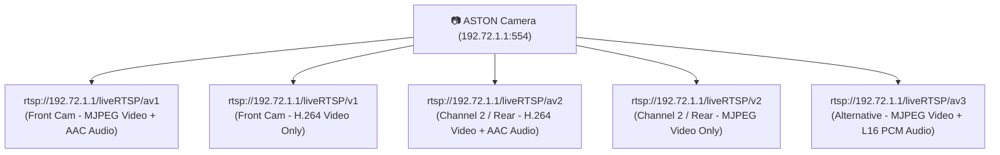

# รายงานผลการวิเคราะห์เฟิร์มแวร์และโพรโทคอลกล้อง ASTON Ultimate X WiFi 2K
## Phase 1 — Firmware Forensics & Live Protocol Discovery

**วันที่ตรวจสอบ:** 6 พฤศจิกายน 2026  
**สภาพแวดล้อม:** Windows 10 | Dual Wi-Fi (Wi-Fi 2: `WK_CarDV_WiFi_7277` @ 192.72.1.101, Wi-Fi: Internet)  
**ไฟล์เฟิร์มแวร์:** `C:\laragon\www\app-ios-astonCamera\SD_CarDV.bin`  
**สถานะการทดสอบ:** Read-only 100% (ไม่มีการแก้ไขระบบ ไม่มีการ Flash หรือส่งคำสั่งควบคุมกล้อง)

---

## 1. VERIFIED_FROM_FIRMWARE (หลักฐานที่พบในไฟล์จริง)

| รายการ | ค่าที่ตรวจพบจริง | หมายเหตุ / Offset |
|---|---|---|
| **SHA-256 Hash** | `5B18635E8BD3D6973567E15452DAE62BBDC613DC9772CA4CBDC043D3E9DDE0B9` | คำนวณจากไฟล์ `SD_CarDV.bin` ขนาดเต็ม |
| **ขนาดไฟล์** | 4,062,038 bytes (~3.87 MB) | |
| **Magic Header** | `AITS` (0x41 0x49 0x54 0x53) | Offset `0x00000000` (สถาปัตยกรรมชิปเซ็ต Alpha Imaging Technology / AIT) |
| **Secondary Magic** | `MCR5` (0x4D 0x43 0x52 0x35) | Offset `0x00000020` |
| **Section Table** | `0x000011B8` (size 2708), `0x00001C4C` (size 512), `0x00001E4C` (size 80), `0x00001E9C` (size 20) | Offset `0x000000E0` – `0x00000140` |
| **Compressed Headers** | GZIP (`0x1F 0x8B`) ที่ `0x0002B49A` LZMA (`0x5D 0x00 0x00`) ที่ `0x00008B58` JFFS2 LE (`0x85 0x19`) ที่ `0x0002224F` | Entropy บริเวณ 0x000186A0–0x001E8480 สูงถึง 7.1–7.28 |
| **Web Server Assets** | `AITlogo.jpg`, `settings.html`, `mj4.html`, `simple.html`, `MenuSettings.html`, `style.css`, `fix.css` | พื้นที่ข้อความดิบ Offset `0x00288000` – `0x002A0000` |
| **XML Schema** | `<camera xmlns="urn:schemas-ait-dvr:device-1-0">` | Offset `0x0028EE36` |
| **Live Stream Elements** | `<title>CarDV Streamer PUSH mode</title>` `img.src = "/cgi-bin/liveMJPEG"` | Offset `0x002912C8`, `0x0029174B` ใน `mj4.html` |
| **Default Network Config** | `Net.Port.Service="554, 80, 80"` `Net.WIFI_AP.SSID="WK_CarDV_WiFi"` `Net.Dev.1.IPV4.Address="192.72.1.1"` | Offset `0x003A6A00` – `0x003A6C50` |
| **Preview/Stream Settings** | `Camera.Preview.MJPEG.w=640`, `h=480`, `fps=20`, `bitrate=2000000` `Camera.Preview.H264.w=640`, `h=480`, `bitrate=2000000` `Camera.Preview.RTSP.rtcp=0`, `av=2`, `keepalive=60` | Offset `0x003A7011` – `0x003A7180` |
| **RTSP Stream Path Hints** | `# 1 Enable liveRTSP/av1 for Audio and Video live streaming` `# 2 Enable liveRTSP/v1` | Offset `0x003A708F`, `0x003A70CB` |
| **Hardware / Sensor** | `FRONTCAMINVERTEDIMAGE=1` `[SENSOR1]` `IQ_FILE_NAME=default_iqfile.bin` `SENSOR_IO_PAD=6` | Offset `0x003A7E17`, `0x003A828F`, `0x003A846B` |

---

## 2. VERIFIED_LIVE (สิ่งที่ยืนยันจากกล้องจริง 192.72.1.1)

| ข้อมูลที่ยืนยัน | ค่าจริงที่ตอบกลับจากกล้อง | หลักฐานการทดสอบ |
|---|---|---|
| **Web Server Signature** | `SERVER: AIT Multimedia Network Solution, UPnP/1.0 devices/1.6.19` `X-User-Agent: redsonic` | ยืนยันจาก HTTP Response Headers บนพอร์ต 80 |
| **Firmware Version บนเครื่อง** | `Camera.Menu.FWversion=K90D.20200720.V2.1` | ยืนยันผ่าน `GET /cgi-bin/Config.cgi?action=get&property=Camera.*` |
| **จำนวนกล้อง (Sensor Source)** | `Camera.Preview.Source.Totals=2` `Camera.Preview.Source.1.Camid=` `Camera.Preview.Source.2.Camid=` | กล้องมี 2 แหล่งภาพจริง (หน้า/หลัง) ยืนยันผ่าน `Camera.Preview.Source.*` |
| **สถานะการบันทึกภาพ** | `Camera.Preview.MJPEG.status=ACTIVE` `Camera.Preview.MJPEG.status.mode=Videomode` `Camera.Preview.MJPEG.status.record=Recording` | กล้องกำลังบันทึกลงการ์ด SD แบบ Looping 3MIN |
| **ความละเอียดภาพพรีวิว** | `MJPEG`: 640x480 @ 20fps, Bitrate 2000000 `H264`: 640x480, Bitrate 2000000 | ค่าพารามิเตอร์ของ Stream พรีวิวตรงกับเฟิร์มแวร์ |
| **จำนวนไฟล์ในระบบ** | `Camera.File.Total=11` (ถึง 12) `Camera.DBFileNum=24+127` `Camera.NormalDBSize=29298` | ฐานข้อมูลไฟล์ใน SD Card มีรายการวิดีโออยู่จริง |
| **เมนูการตั้งค่ากล้อง** | `DefMode=VIDEO`, `LoopingVideo=3MIN`, `EV=EVN200`, `GSensor=LEVEL4`, `Flicker=60Hz`, `SD0=READY` | ดึงค่าสถานะสำเร็จทั้งหมดผ่าน `Config.cgi` |
| **พอร์ตที่เปิดให้บริการ** | พอร์ต 80 (HTTP) = **OPEN** พอร์ต 554 (RTSP) = **OPEN** พอร์ต 8554, 8080, 8888 = **CLOSED** | ยืนยันผ่านการเชื่อมต่อ TCP Socket |
| **RTSP Server Capabilities** | รองรับคำสั่ง: `DESCRIBE, SETUP, TEARDOWN, PLAY, PAUSE, GET_PARAMETER` | ตอบกลับ `RTSP/1.0 200 OK` ต่อคำสั่ง `OPTIONS` |

---

## 3. HYPOTHESIS (ข้อมูลที่ยังไม่ยืนยัน / ข้อสมมติฐาน)

1. **การเข้าถึงไฟล์วิดีโอย้อนหลัง (Playback / Download):**
   - กล้องรายงาน `Camera.File.Total=11` และ `Camera.DBFileNum=24+127` แต่คำขอ `Camera.File.0.*` คืนค่า `703 Unknown CGI-PARAM`
   - สมมติฐาน: การดึงรายการไฟล์อาจต้องเปลี่ยนโหมดกล้องเป็น Playback (`Camera.Menu.UIMode=PLAYBACK`) หรือใช้ CGI เฉพาะของ AIT เช่นคำสั่งคิวรีฐานข้อมูล SQLite/FAT หรือโปรโตคอล UPnP ContentDirectory Service
2. **การทำงานของ `/cgi-bin/liveMJPEG`:**
   - ใน `mj4.html` มีการผูกรูปภาพเข้ากับ `/cgi-bin/liveMJPEG` แต่เมื่อเรียกตรงคืนค่า 404
   - สมมติฐาน: สตรีม MJPEG ผ่าน HTTP อาจต้องถูกกระตุ้นผ่านการตั้งค่าเซสชันหรือเปิดโหมดการส่งภาพก่อน หรือกล้องตั้งค่าเริ่มต้นให้สตรีมผ่าน RTSP เป็นหลัก
3. **การเข้าถึงสตรีมกล้องหลัง:**
   - สตรีม `rtsp://192.72.1.1/liveRTSP/av2` ให้ข้อมูล SDP สำเร็จ (H.264 + AAC) แต่อัตราส่วน/ความละเอียดจริงขณะต่อหรือไม่ต่อกล้องหลังต้องรอการทดสอบถอดรหัสเฟรมใน Phase 2

---

## 4. HTTP_ENDPOINTS (ผลการตรวจสอบแต่ละ Endpoint)

| Method | Endpoint | ผลลัพธ์ / Status | รายละเอียดข้อมูลที่ตอบกลับ |
|---|---|---|---|
| `GET` | `/cgi-bin/Config.cgi?action=get&property=Camera.*` | `200 OK` (text/plain) | คืนค่าสถานะฮาร์ดแวร์, แบตเตอรี่, เมนู, ความละเอียด, จำนวนกล้อง (Totals=2), เวลา MJPEG Timestamp ครบถ้วน |
| `GET` | `/cgi-bin/Config.cgi?action=get&property=Camera.Preview.*` | `200 OK` (text/plain) | คืนค่า Adas, H264, MJPEG, RTSP และ Source Totals |
| `GET` | `/cgi-bin/Config.cgi?action=get&property=Camera.File.*` | `200 OK` (text/plain) | `Camera.File.Total=11` |
| `GET` | `/cgi-bin/Config.cgi?action=get&property=Camera.DBFileNum` | `200 OK` (text/plain) | `Camera.DBFileNum=22+127` |
| `GET` | `/cgi-bin/Config.cgi?action=get&property=Camera.Record.*` | `200 OK` (text/plain) | `Camera.Record.Remaining=420`, `Total=19991` |
| `GET` | `/cgi-bin/Config.cgi?action=get&property=Camera.Preview.Source.*` | `200 OK` (text/plain) | `Camera.Preview.Source.Totals=2` |
| `GET` | `/settings.html` | `200 OK` (text/html) | หน้าเว็บหลักสำหรับลิงก์ไป `simple.html` และ `MenuSettings.html` พร้อม `AITlogo.jpg` |
| `GET` | `/MenuSettings.html` | `200 OK` (text/html) | หน้าจัดการ Movie Resolution (1080P30, 720P60, 720P30), Image Resolution, Motion Detection, Flicker, AWB |
| `GET` | `/simple.html` | `200 OK` (text/html, UTF-16BE) | หน้าตั้งค่า WiFi AP (SSID, Key, MAC, IP) |
| `GET` | `/mj4.html` | `200 OK` (text/html) | หน้าพรีวิว MJPEG PUSH mode ของ AIT CarDV Streamer |
| `GET` | `/AITlogo.jpg` | `200 OK` (image/jpeg) | โลโก้ Alpha Imaging Technology |
| `GET` | `/` | `404 Not Found` | ไม่มีหน้า index เริ่มต้น ต้องเข้าผ่าน path เฉพาะ |
| `GET` | `/cgi-bin/liveMJPEG` | `404 Not Found` | ยังไม่พร้อมให้บริการสตรีมตรงโดยไม่มีการกระตุ้นเซสชัน |
| `GET` | `/SD/`, `/DCIM/`, `/sd/` | `404 Not Found` | กล้องไม่อนุญาตให้ Directory Browsing แฟ้ม SD โดยตรงผ่านเว็บพอร์ต 80 |

---

## 5. RTSP_RESULTS (ผลการตรวจสอบ Stream บนพอร์ต 554)

ทดสอบส่งคำสั่ง `OPTIONS` และ `DESCRIBE` แบบ Read-only ได้รับ **SDP (Session Description Protocol)** ยืนยันโครงสร้างแทร็กจริงดังนี้:

### สรุปสตรีม RTSP ที่เปิดใช้งานจริงบนกล้อง:

### รายละเอียด SDP แต่ละสตรีม:

#### 1. `rtsp://192.72.1.1/liveRTSP/v1` (แนะนำสำหรับภาพสดกล้องหน้า H.264)
- **สถานะ:** `200 OK`
- **วิดีโอ (track0):** RTP payload 96 (`H264/90000`)
- **Profile / Level:** Baseline (`profile-level-id=42401F`)
- **SPS / PPS Sets:** `sprop-parameter-sets=Z0JAH6aAUAW6aAQ=,aM44gA==`
- **เสียง:** ไม่มี (Video Only) ประหยัดแบนด์วิดท์ เหมาะกับการดึงภาพสดบน iOS

#### 2. `rtsp://192.72.1.1/liveRTSP/av1` (กล้องหน้าพร้อมเสียง)
- **สถานะ:** `200 OK`
- **วิดีโอ (track0):** RTP payload 26 (JPEG / Motion JPEG)
- **เสียง (track1):** RTP payload 97 (`mpeg4-generic/16000/2` AAC Stereo 16kHz)

#### 3. `rtsp://192.72.1.1/liveRTSP/av2` (สตรีมแชนเนล 2 / กล้องหลัง)
- **สถานะ:** `200 OK`
- **วิดีโอ (track0):** RTP payload 96 (`H264/90000`, profile `42401F`)
- **เสียง (track1):** RTP payload 97 (`mpeg4-generic/16000/2` AAC Stereo 16kHz)

#### 4. `rtsp://192.72.1.1/liveRTSP/v2`
- **สถานะ:** `200 OK`
- **วิดีโอ (track0):** RTP payload 26 (JPEG Video)

---

## 6. REAR_CAMERA (เบาะแสกล้องหลัง)

1. **การยืนยันระดับฮาร์ดแวร์และสถานะ:**
   - `Camera.Preview.Source.Totals=2` บนกล้องจริง ยืนยันว่าระบบควบคุมวิดีโอจัดสรร 2 แชนเนลอิสระ
   - ในเฟิร์มแวร์พบการแยก `[SENSOR1]` และการตั้งค่า pad I/O ชัดเจน
2. **การแยกเส้นทางสตรีมภาพสด:**
   - กล้องจัดสรร path RTSP แยกกันชัดเจน:
     - **กล้องหน้า / Stream 1:** `/liveRTSP/v1` (H.264) หรือ `/liveRTSP/av1`
     - **กล้องหลัง / Stream 2:** `/liveRTSP/av2` (H.264 + AAC) หรือ `/liveRTSP/v2` (MJPEG)
3. **ความเข้ากันได้กับแอป iOS:**
   - เนื่องจากทั้งสองแชนเนลรองรับ H.264 Baseline Profile (`profile-level-id=42401F`) ทำให้สามารถใช้ **AVFoundation / VideoToolbox** บน iOS เพื่อถอดรหัสแบบฮาร์ดแวร์ (Hardware Acceleration) ได้ทั้งกล้องหน้าและกล้องหลังอย่างลื่นไหลและกินแบตเตอรี่ต่ำ

---

## 7. NEXT_STEPS (แผนการดำเนินงาน Phase 2)

1. **การทดสอบรับและถอดรหัสสตรีมภาพสด (Live Streaming Pipeline):**
   - สร้าง Python Script (เช่นใช้ `opencv-python` หรือ RTSP client แบบเบา) ทดสอบดึงเฟรม H.264 จาก `rtsp://192.72.1.1/liveRTSP/v1` และ `/liveRTSP/av2` มาแสดงผลรูป snapshot เพื่อยืนยันว่ากล้องหน้าและกล้องหลังส่งภาพจริง
2. **เจาะลึกโพรโทคอลรายการไฟล์ (Video File List & Playback Discovery):**
   - วิเคราะห์พฤติกรรมของแอป Ti2Cam หรือคำสั่ง AIT Command ชุดเพิ่มเติมในการสลับเข้าโหมด Playback เพื่อให้กล้องตอบรายการไฟล์วิดีโอ MP4/MOV ใน SD Card
   - ทดสอบว่าการดาวน์โหลดไฟล์ใช้วิธี HTTP GET ตามพาร์ทไฟล์ตรง หรือผ่าน RTSP Playback URL
3. **การออกแบบสถาปัตยกรรมแอป iOS (SwiftUI + VideoToolbox):**
   - ออกแบบโมดูล RTSP Client ใน Swift ที่เชื่อมต่อกับ `liveRTSP/v1` (Front) และ `liveRTSP/av2` (Rear)
   - สร้าง UI สลับมุมมองกล้องหน้า–หลังแบบเรียลไทม์

---
*(บันทึกรายงานนี้ลง `phase1-firmware-protocol-report.md` เรียบร้อยแล้ว พร้อมหยุดรอคำสั่งก่อนดำเนินการ Phase 2)*
