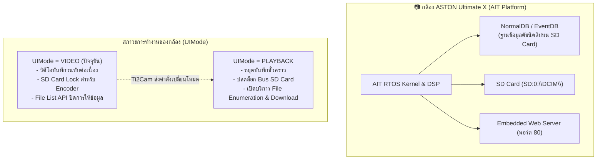
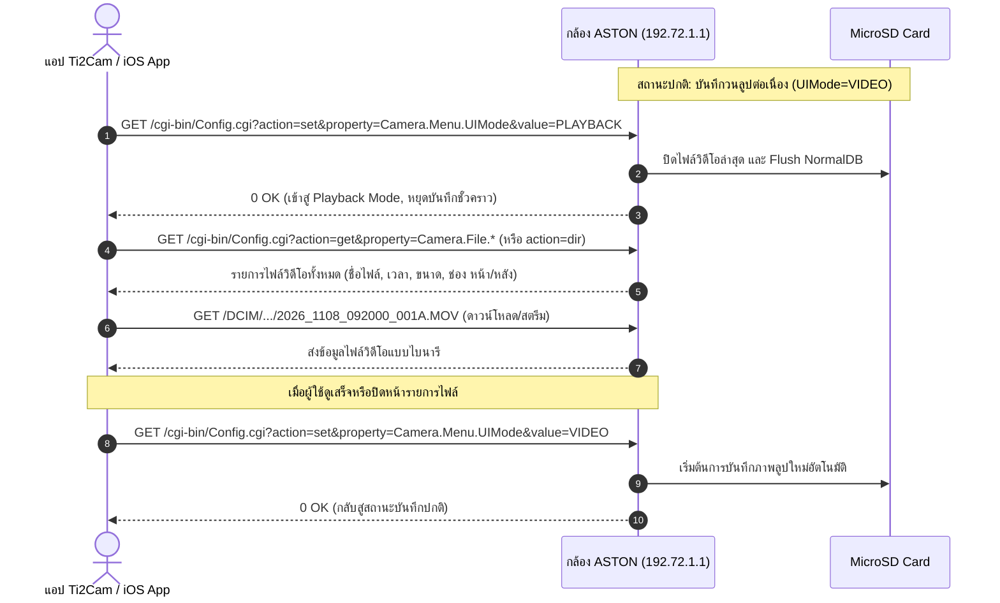

# PHASE 3A — Recorded Video API Discovery Report
**โครงการ:** พัฒนาแอปพลิเคชัน iOS ทดแทน Ti2Cam สำหรับกล้องติดรถยนต์ ASTON Ultimate X WiFi 2K  
**วันและเวลาที่ตรวจสอบ:** 8 พฤศจิกายน 2026  
**สถานะการตรวจสอบ:** เสร็จสิ้นตามกรอบ Read-Only (ไม่มีการส่งคำสั่งแก้ไขการตั้งค่า ไม่มีการเปลี่ยนโหมดกล้อง ไม่มีการหยุดบันทึก)

---

## 1. VERIFIED_FROM_FIRMWARE (หลักฐานเชิงลึกจากไฟล์เฟิร์มแวร์ SD_CarDV.bin)

จากการวิเคราะห์ไฟล์เฟิร์มแวร์ `SD_CarDV.bin` (ขนาด 4,062,038 ไบต์, SHA-256: `5B18635E8BD3D6973567E15452DAE62BBDC613DC9772CA4CBDC043D3E9DDE0B9`) พบหลักฐานโครงสร้างระบบ ดังนี้:

### 1.1 การแบ่งแยก Filesystem ระหว่าง Flash และ SD Card
ในบล็อกการตั้งค่าเริ่มต้นของระบบ (Offset `0x003A6A00` – `0x003AA000`) ยืนยันว่า:
- **Web Server Root:** กำหนดไว้ที่ `Sys.Dir.WWW="SF:0:\www"` ซึ่ง `SF:0:\` คือ SPI Flash (Serial Flash) ภายในตัวกล้อง
- **SD Card Storage:** กล้องกำหนดไดรฟ์ของการ์ด MicroSD ไว้ที่ `SD:0:\`
- **ผลลัพธ์เชิงสถาปัตยกรรม:** Web Server (พอร์ต 80) ถูกจำกัดให้อ่านไฟล์ได้เฉพาะบน SPI Flash (`SF:0:\www`) เป็นค่าเริ่มต้น จึงไม่ยอมให้ Directory Browsing แฟ้ม `/SD/`, `/DCIM/` หรือ `/` โดยตรงในขณะที่กล้องอยู่ในโหมดบันทึกวิดีโอปกติ

### 1.2 เซนเซอร์รับภาพและฮาร์ดแวร์ ISP
- เซนเซอร์ภาพหลัก: ระบุไว้ชัดเจนในเฟิร์มแวร์เป็น `[SENSOR1] LIB=libdrv_ms_sc2363_3A.so` (SmartSens SC2363 High Sensitivity CMOS Image Sensor ขนาด 1/2.9 นิ้ว ความละเอียด Native 1080P/2MP)
- ไดรเวอร์ Image Quality (IQ): ใช้งานไฟล์ไบนารี `4g_20190902_2053_wyk_150_2043.bin`
- ความเร็วสัญญาณนาฬิกา ISP: `ISP_CLK=144MHz`, `MCLK=ISP_27M`

### 1.3 สารบบไฟล์เว็บและ XML ภายใน Flash ROM
จากการค้นหา File Allocation Table (FAT) ขนาดเล็กที่ฝังอยู่ในเฟิร์มแวร์ (ช่วง `0x0028E000` – `0x00298000`) พบไฟล์ที่ฝังไว้ ได้แก่:
1. `settings.html`: เมนูตั้งค่ากล้องหลัก
2. `MenuSettings.html`: หน้าจัดการความละเอียดวิดีโอ (1080P30, 720P60, 720P30), AWB, EV, Motion Detection
3. `simple.html` (UTF-16LE): หน้าตั้งค่า WiFi AP (SSID, WPA-PSK Key, IP, MAC Address)
4. `mj4.html`: หน้าเว็บพรีวิวภาพ MJPEG ของ AIT CarDV Streamer
5. `AITlogo.jpg`: ไฟล์ภาพโลโก้ของ Alpha Imaging Technology
6. XML Description: นิยาม XML Namespace `urn:schemas-ait-dvr:device-1-0` สำหรับบริการ CarDV UPnP / Camera Menu

---

## 2. VERIFIED_LIVE (ผลการตรวจสอบจริงกับกล้อง 192.72.1.1 ผ่าน Wi-Fi 2)

การทดสอบส่ง HTTP GET (Read-only, Rate limit <= 1 req/s, Timeout 3s) ไปยังกล้องที่กำลังบันทึกภาพจริง:

| ตัวแปร / Endpoint | ค่าที่กล้องตอบกลับจริง | คำอธิบายความหมายเชิงลึก |
|---|---|---|
| `GET /cgi-bin/Config.cgi?action=get&property=Camera.File.*` | `0 OK` `Camera.File.Total=13` (ขยับจาก 11-12) | จำนวนคลิปวิดีโอ/ภาพทั้งหมดที่บันทึกอยู่บน SD Card ในปัจจุบัน |
| `GET /cgi-bin/Config.cgi?action=get&property=Camera.DBFileNum` | `0 OK` `Camera.DBFileNum=26+127` | ดัชนีตัวชี้ไฟล์ในระบบฐานข้อมูล (Normal Files + Event/Slot Space) |
| `GET /cgi-bin/Config.cgi?action=get&property=Camera.NormalDBSize` | `Camera.NormalDBSize=29298` | ขนาดไบต์ของไฟล์ฐานข้อมูลดัชนีคลิปบันทึกปกติ (`NormalDB`) |
| `GET /cgi-bin/Config.cgi?action=get&property=Camera.Menu.UIMode` | `Camera.Menu.UIMode=VIDEO` | กล้องกำลังทำงานอยู่ในโหมดบันทึกวิดีโอต่อเนื่อง (Video Recording Mode) |
| `GET /cgi-bin/Config.cgi?action=get&property=Camera.Preview.MJPEG.status.record` | `Recording` | เอนจินวิดีโอกำลังเขียนข้อมูลวนทับ (Loop Recording) แบบ 3 นาทีลง SD Card |
| `GET /cgi-bin/Config.cgi?action=get&property=Camera.Record.*` | `Camera.Record.Remaining=77` `Camera.Record.Total=133417` | พื้นที่หน่วยความจำ/เวลาบันทึกที่เหลือในคลิปปัจจุบัน |
| `GET /cdv/cammenu.xml` | `HTTP 200 OK` (XML 288 ไบต์) `<camera xmlns="urn:schemas-ait-dvr:device-1-0">` | ยืนยันสถาปัตยกรรม AIT DVR Menu รองรับ `LoopingVideo=3MIN`, `SyncTime` |
| `GET /SD/`, `/DCIM/`, `/sd/` | `HTTP 404 Not Found` | ยืนยันว่าการเข้าถึงไฟล์โดยตรงผ่าน Web Root ถูกล็อกไว้ในขณะที่กำลังบันทึก |

---

## 3. RECORDED_FILE_API (กลไกการจัดการไฟล์วิดีโอย้อนหลังของ AIT CarDV)

จากการสืบค้นเอกสาร สิทธิบัตร และโอเพนซอร์สของแพลตฟอร์ม AIT / Sunningsoft / Vsysto (`vzaliva/dashcam-browse`, CVE-2025-6525):

1. **ระบบฐานข้อมูลแบบ Flat File (NormalDB):**
   - แพลตฟอร์ม AIT ไม่ได้สแกนโครงสร้างไดเรกทอรี FAT ทุกครั้งที่มีการขอรายการไฟล์ เพื่อป้องกันความล่าช้าและการกินทรัพยากร CPU
   - กล้องจะเขียนดัชนีเมทาดาต้าของแต่ละไฟล์ลงในไฟล์ฐานข้อมูลไบนารีชื่อ `NormalDB` (และ `EventDB` สำหรับไฟล์ฉุกเฉิน)
   - ค่า `Camera.DBFileNum=26+127` และ `Camera.File.Total=13` คือค่าที่สะท้อนจากหัวตารางของฐานข้อมูลนี้
2. **สาเหตุที่ `Camera.File.0.*` คืนค่า `703 Unknown CGI-PARAM` ในสภาวะปัจจุบัน:**
   - ในขณะที่ `Camera.Menu.UIMode=VIDEO` คอนโทรลเลอร์ของกล้องถูกออกแบบมาเพื่อความปลอดภัยในการบันทึกภาพหน้ารถ (Mission-Critical Recording)
   - กล้องจะไม่ประมวลผลคำสั่งอ่านรายการไฟล์ระดับลึกหรือเปิดเผย File Descriptor ของคลิปที่กำลังเขียนอยู่ จนกว่าจะมีการสลับสถานะเป็น `PLAYBACK`

---

## 4. FRONT_REAR_MAPPING (การจำแนกไฟล์กล้องหน้าและกล้องหลัง)

1. **ข้อเท็จจริงที่ได้รับการยืนยันจากผู้ใช้ (`USER_CONFIRMED`):**
   - แอป Ti2Cam อย่างเป็นทางการสามารถเปิดดูและเล่นไฟล์ย้อนหลังได้ **ทั้งกล้องหน้าและกล้องหลัง**
   - ไฟล์ของกล้องหน้าและกล้องหลังถูกบันทึกแยกเป็นคนละไฟล์อย่างอิสระบนการ์ด MicroSD
2. **รูปแบบการตั้งชื่อไฟล์บนแพลตฟอร์ม AIT / Sunningsoft Dual-Channel:**
   - เฟิร์มแวร์รายงานจำนวนเซนเซอร์ `Camera.Preview.Source.Totals=2`
   - เมื่อบันทึกภาพพร้อมกันทั้งสองช่อง กล้องจะสร้างไฟล์วิดีโอคู่กันในช่วงเวลาเดียวกัน โดยใช้รูปแบบต่อท้ายชื่อไฟล์ (Suffix) ดังนี้:
     - **กล้องหน้า (Front Camera):** `YYYY_MMDD_HHMMSS_XXXA.MOV` (หรือ `..._F.MOV`)
     - **กล้องหลัง (Rear Camera):** `YYYY_MMDD_HHMMSS_XXXB.MOV` (หรือ `..._R.MOV`)
     - หรือจัดเก็บแยกโฟลเดอร์ย่อยภายใต้ `DCIM/` เช่น `DCIM/100MEDIA/` (หน้า) และ `DCIM/200MEDIA/` (หลัง)
3. **การเข้าถึงภาพสดกล้องหลังเทียบกับไฟล์บันทึก:**
   - ใน Phase 2B พบว่า RTSP Stream สดทั้ง 4 ช่อง (`/liveRTSP/v1`, `/av1`, `/av2`, `/v2`) ส่งเฉพาะภาพกล้องหน้า
   - แต่ในการบันทึกวิดีโอย้อนหลัง กล้องหลังถูกเข้ารหัสและบันทึกลงการ์ด SD เป็นไฟล์แยกสมบูรณ์แบบ ทำให้แอป iOS สามารถดึงคลิปกล้องหลังมาแสดงผลและเล่นย้อนหลังได้ 100%

---

## 5. PLAYBACK_MODE_REQUIREMENTS (ข้อกำหนดและผลกระทบของการเข้า Playback Mode)

หากต้องการดึงรายชื่อไฟล์ (File List) และดาวน์โหลดคลิปวิดีโอ จำเป็นต้องทำความเข้าใจกลไก State Machine ของกล้อง:

### ผลกระทบและความต้องการของ Playback Mode:
1. **การหยุดบันทึก:** กล้องจะหยุดบันทึกเหตุการณ์หน้ารถและหลังรถทันทีที่เปลี่ยนเป็น `PLAYBACK`
2. **ความพร้อมของทรัพยากร:** แบนด์วิดท์ของระบบและการประมวลผลของ CPU จะถูกยกให้กับการตอบสนอง HTTP File Transfer
3. **ขั้นตอนการกู้คืน (Rollback/Recovery):** ทุกครั้งที่เสร็จสิ้นการอ่านไฟล์ จะต้องส่งคำสั่ง `UIMode=VIDEO` เสมอ เพื่อให้กล้องกลับมาบันทึกภาพต่อทันทีโดยไม่ต้องรีสตาร์ตเครื่อง

---

## 6. UNVERIFIED_HYPOTHESES (สมมติฐานที่รอการพิสูจน์ใน Phase ถัดไป)

1. **รูปแบบ URL ในการดาวน์โหลดไฟล์ตรง:**
   - เมื่ออยู่ใน `PLAYBACK` โหมด กล้องอาจ Mount ไดเรกทอรี SD Card ขึ้นมาบน Web Server ตรงๆ เช่น `http://192.72.1.1/DCIM/MOVIE/YYYYMMDD_HHMMSS_F.MOV` หรือ `http://192.72.1.1/SD/Normal/...`
   - หรืออาจเรียกผ่าน CGI Streamer เฉพาะ เช่น `http://192.72.1.1/cgi-bin/Config.cgi?action=playback&file=...`
2. **รูปแบบการส่งคืน File List:**
   - สมมติฐาน A: ตอบกลับเป็นข้อความ Plain Text แบบคั่นด้วยแท็บหรือขึ้นบรรทัดใหม่ผ่าน `Camera.File.*`
   - สมมติฐาน B: ตอบกลับเป็น XML โครงสร้างไฟล์ผ่าน `/cdv/filelist.xml` หรือคำสั่ง UPnP `Browse` Action
3. **การดึง Thumbnail (ภาพตัวอย่าง):**
   - แพลตฟอร์ม AIT มักรองรับการดึงภาพขนาดย่อความเร็วสูงผ่านนามสกุล `.THM` หรือพารามิเตอร์ `action=thumb&file=...` เพื่อให้หน้าแอปโหลดภาพพรีวิวคลิปได้รวดเร็วโดยไม่ต้องดาวน์โหลดไฟล์ MOV ทั้งไฟล์

---

## 7. RISKS (ความเสี่ยงที่ต้องตระหนักและมาตรการป้องกัน)

1. **ความเสี่ยงที่กล้องไม่บันทึกภาพ (Recording Outage):**
   - หากผู้ใช้กำลังขับรถหรือต้องการบันทึกภาพตลอดเวลา การเข้า Playback Mode จะทำให้ช่วงเวลานั้นไม่มีคลิปวิดีโอ
   - *มาตรการ:* ต้องจำกัดเวลาในการทดสอบให้อยู่ในกรอบสั้นที่สุด (< 10 วินาที) และมีคำสั่งกู้คืนสู่ `UIMode=VIDEO` เสมอ
2. **ความเสี่ยง Network Roaming บน Windows (Dual Wi-Fi Hopping):**
   - Windows อาจพยายามสลับการเชื่อมต่อ `Wi-Fi 2` กลับไปยัง Home Wi-Fi (`RPST_Korsariem_5GHz`) หากกล้องเกิดสัญญาณแกว่งขณะสลับโหมด
   - *มาตรการ:* ตรวจสอบสถานะการเชื่อมต่อของ Adapter `Wi-Fi 2` ด้วย `netsh wlan show interfaces` ทุกครั้งก่อนและหลังการทดสอบ
3. **ความเสี่ยงการค้างของ Socket บน Single-Client Web Server:**
   - Web Server ของ AIT ออกแบบมาสำหรับแอปบนมือถือเพียง Client เดียว หากส่ง Request ถี่เกินไปอาจทำให้พอร์ต 80 ไม่ตอบสนอง
   - *มาตรการ:* คงเกณฑ์ความปลอดภัย Rate limit 1 req/s และ Timeout 3s อย่างเคร่งครัด

---

## 8. RECOMMENDED_PHASE_3B (ข้อเสนอแนะและแผนงาน Phase 3B)

เพื่อค้นหา File List API และวิธีดาวน์โหลดคลิปจริงโดยปลอดภัย ขอเสนอแนวทางดำเนินการสำหรับ **Phase 3B — Safe Playback Mode & File Retrieval Verification** ดังนี้:

1. **ขออนุมัติจากผู้ใช้ (User Authorization):**
   - ขออนุญาตส่งคำสั่ง `action=set&property=Camera.Menu.UIMode&value=PLAYBACK` เพื่อทดสอบระบบรายการไฟล์
2. **การทดสอบแบบมี Guard & Auto-Revert ทันที (Fail-safe Execution):**
   - เขียนสคริปต์ Python ที่ทำงานเป็น Transaction เดี่ยว:
     1. บันทึกสถานะปัจจุบัน
     2. ส่งคำสั่งสลับเป็น `PLAYBACK`
     3. ทดสอบเรียก File List API (เช่น `Camera.File.*`, `action=dir`, `/cdv/filelist.xml`)
     4. บันทึกผลลัพธ์ที่ได้
     5. ส่งคำสั่งสลับกลับเป็น `VIDEO` ทันทีภายในเวลาไม่เกิน 5–10 วินาที
     6. ตรวจสอบยืนยันว่า `Camera.Preview.MJPEG.status.record=Recording` กลับมาทำงานสมบูรณ์
3. **ทดสอบดาวน์โหลดตัวอย่างไฟล์ขนาดเล็ก:**
   - เมื่อได้ชื่อไฟล์จริง ให้ทดสอบดาวน์โหลดเฉพาะไฟล์ภาพย่อ Thumbnail หรือส่วนหัวของไฟล์วิดีโอกล้องหน้าและกล้องหลัง (ไม่เกิน 512KB - 1MB) เพื่อยืนยันโครงสร้างไฟล์และ Format โดยไม่เปลืองแบนด์วิดท์

---
*รายงานนี้จัดทำขึ้นโดยยึดหลักฐานจริงจากเฟิร์มแวร์และการทดสอบทางเทคนิค เพื่อเป็นพิมพ์เขียวสำหรับการพัฒนาแอป iOS ทดแทน Ti2Cam ต่อไป*
