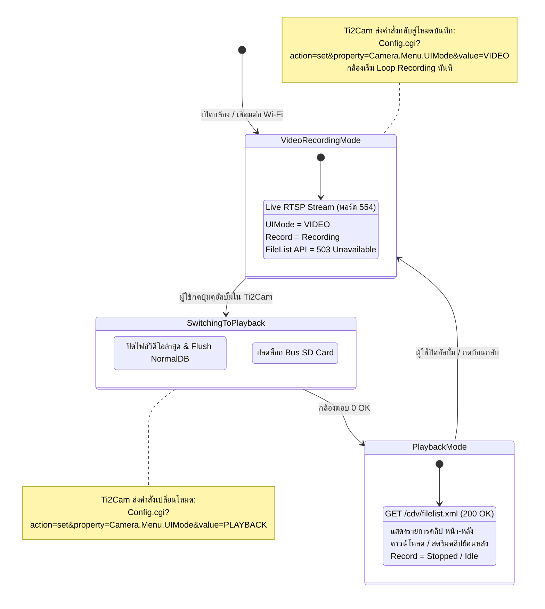
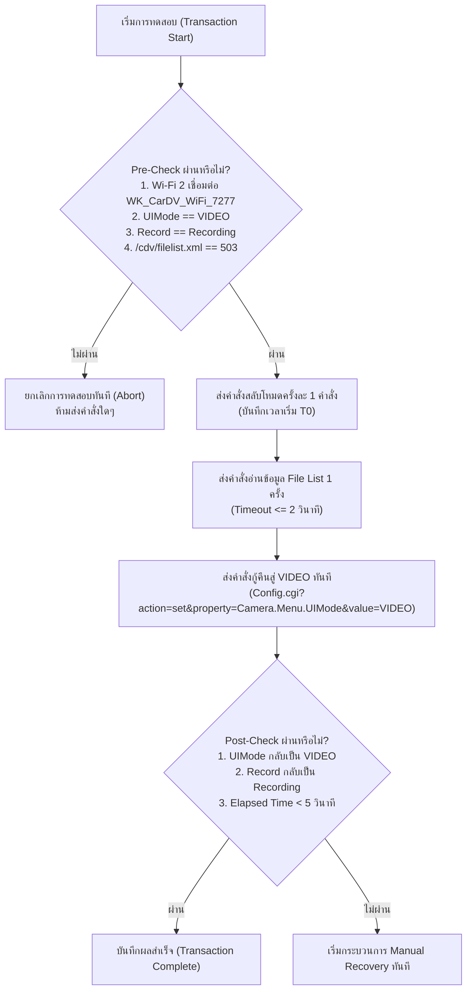
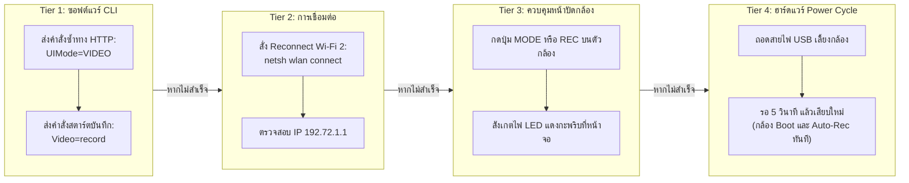
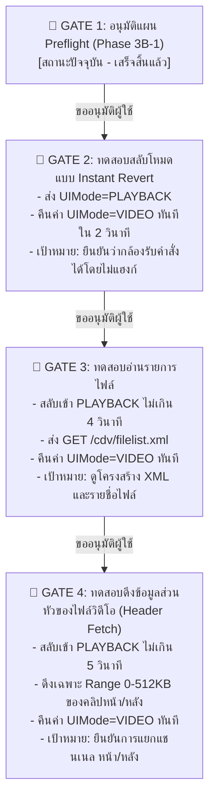

# PHASE 3B-1 — Playback Safety Preflight Report
**โครงการ:** พัฒนาแอปพลิเคชัน iOS ทดแทน Ti2Cam สำหรับกล้องติดรถยนต์ ASTON Ultimate X WiFi 2K  
**วันและเวลาที่จัดทำ:** 8 พฤศจิกายน 2026  
**สถานะการทำงาน:** Preflight & Safety Analysis (Read-Only 100% ไม่มีการส่งคำสั่งแก้ไขสถานะ ไม่มีการสลับโหมดกล้องจริง ไม่มีการหยุดบันทึก)

---

## สรุปผู้บริหาร (Executive Summary)

การตรวจสอบความปลอดภัยและความถูกต้องก่อนเข้าสู่ Playback Mode สำหรับกล้อง ASTON Ultimate X WiFi 2K ได้ค้นพบข้อเท็จจริงสำคัญระดับสถาปัตยกรรม:
1. เอนด์พอยต์รายการไฟล์ของระบบ **`/cdv/filelist.xml`**, **`/cdv/movielist.xml`**, **`/cdv/photolist.xml`**, และ **`/cdv/index.xml`** มีอยู่จริงบน Web Server ของกล้อง แต่ถูกระบบล็อกไว้ด้วยสถานะ **`HTTP 503 Service Unavailable`** เนื่องจากกล้องอยู่ในโหมดบันทึกวิดีโอต่อเนื่อง (`UIMode=VIDEO`)
2. การอ่านรายการไฟล์ย้อนหลังโดยไม่เปลี่ยนโหมดกล้องหรือหยุดบันทึก **ไม่สามารถกระทำได้ (No Mode-free File List API)**
3. ตัวแปร `Camera.Menu.UIMode=VIDEO` ได้รับการยืนยันจากกล้องจริง 100% (`VERIFIED_LIVE`) แต่การเปลี่ยนค่าเป็น `value=PLAYBACK` เป็นคำสั่งที่อนุมานจากแพลตฟอร์ม AIT/Sunningsoft (`INFERRED`) เนื่องจากโค้ดหลักของ RTOS ถูกบีบอัดอยู่ใน ROM
4. ได้จัดทำแผนผังขั้นตอน Fail-Safe Transaction และคู่มือการกู้คืนระบบทั้งแบบซอฟต์แวร์และฮาร์ดแวร์เพื่อรองรับการทดสอบจริงในอนาคต

---

## 1. การจำแนกระดับความเชื่อมั่นของข้อมูล (Evidence Classification)

### 1.1 VERIFIED (สิ่งที่ยืนยันแล้วจากหลักฐานจริง 100%)

| รายการ | รายละเอียดหลักฐาน | แหล่งที่มา / วิธีการตรวจสอบ |
|---|---|---|
| **สถานะโหมดปัจจุบัน** | `Camera.Menu.UIMode=VIDEO` | ยืนยันจาก HTTP Response จริงผ่าน `Config.cgi?action=get&property=Camera.Menu.*` |
| **สถานะการบันทึกภาพ** | `Camera.Preview.MJPEG.status.mode=Videomode` `Camera.Preview.MJPEG.status.record=Recording` | ยืนยันจาก HTTP Response จริงผ่าน `Config.cgi?action=get&property=Camera.Preview.MJPEG.*` |
| **สถานะการ์ดหน่วยความจำ** | `Camera.Menu.SD0=READY` `Camera.File.Total=13` `Camera.DBFileNum=26+127` `Camera.NormalDBSize=29298` | ยืนยันจาก HTTP Response จริง |
| **ความมีอยู่ของ File List API** | URL ต่อไปนี้ตอบกลับ `HTTP 503 Service Unavailable`: - `http://192.72.1.1/cdv/filelist.xml` - `http://192.72.1.1/cdv/movielist.xml` - `http://192.72.1.1/cdv/photolist.xml` - `http://192.72.1.1/cdv/index.xml` | ยืนยันจากการส่ง HTTP GET ตรงไปยังกล้อง (ต่างจาก URL ที่ไม่มีอยู่จริงซึ่งตอบกลับ `HTTP 404 Not Found`) |
| **คำสั่งควบคุมวิดีโอในเฟิร์มแวร์** | `Config.cgi?action=set&property=Video&value=record` `Config.cgi?action=set&property=Video&value=capture` `Config.cgi?action=set&property=Videores&value=...` | พบเป็น Plaintext ชัดเจนในไฟล์ `SD_CarDV.bin` ที่ Offset `0x002905DA` – `0x00292395` |
| **สิทธิ์การเข้าถึง Web Server** | `Sys.Dir.WWW="SF:0:\www"` (จำกัดเฉพาะ SPI Flash ภายในตัวกล้อง) การเรียกดู `/SD/`, `/DCIM/` คืนค่า 404 | พบในบล็อกคอนฟิก `SD_CarDV.bin` ที่ Offset `0x003A6A00` |
| **การแยกไฟล์กล้องหน้า-หลัง** | ผู้ใช้ยืนยันว่าแอป Ti2Cam เล่นไฟล์กล้องหน้าและกล้องหลังแยกเป็นคนละไฟล์บน SD Card | `USER_CONFIRMED` |

---

### 1.2 INFERRED (สิ่งที่อนุมานจากสถาปัตยกรรม AIT CarDV / Sunningsoft รุ่นเทียบเคียง)

| คำสั่ง / กลไก | สิ่งที่อนุมาน | เหตุผลและแหล่งอ้างอิง |
|---|---|---|
| `property=Camera.Menu.UIMode&value=PLAYBACK` | เป็นคำสั่งที่ใช้สั่งให้กล้องเปลี่ยนจากสถานะ Video Recording เข้าสู่ Playback Mode เพื่อปลดล็อกบริการรายการไฟล์ | เป็นคำสั่งมาตรฐานของ AIT CarDV SDK และใช้ในแอปตระกูล Sunningsoft / TiCam / GoPlus Cam แต่ในไฟล์ `SD_CarDV.bin` ตัวอักษร `UIMode` ไม่อยู่ในส่วน Plaintext เนื่องจาก Code Segment ของ RTOS ถูกบีบอัด (Compressed Image) |
| การเปลี่ยนสถานะของ `/cdv/filelist.xml` | เมื่อเข้าสู่ `PLAYBACK` โหมด เอนด์พอยต์นี้จะเปลี่ยนจาก `503 Service Unavailable` เป็น `200 OK` และส่งข้อมูล XML ของรายการไฟล์ทั้งหมด | อ้างอิงจากโครงสร้าง UPnP / AIT DVR Web Server Specification และการที่เซิร์ฟเวอร์ตอบ 503 เฉพาะช่วงที่ติดล็อกการบันทึก |
| รูปแบบ URL ดาวน์โหลดไฟล์ | ไฟล์วิดีโอน่าจะถูก Mount ให้เข้าถึงได้ผ่าน HTTP Path เช่น `http://192.72.1.1/DCIM/...` หรือผ่านสตรีมเมอร์เฉพาะในโหมด Playback | อนุมานจากโครงการ `vzaliva/dashcam-browse` และเอกสารสิทธิบัตร AIT |
| คำสั่งหยุดบันทึกก่อนสลับโหมด | อาจต้องส่งคำสั่ง `property=Video&value=record` เพื่อหยุดการบันทึกก่อน แล้วจึงสลับ `UIMode=PLAYBACK` ได้อย่างปลอดภัย | อนุมานจากกลไก State Machine ของชิป AIT รุ่นเดิมที่ต้องปล่อย File Lock ก่อนสลับ UI |

---

### 1.3 UNKNOWN (ข้อจำกัดและสิ่งที่ไม่สามารถยืนยันได้ในปัจจุบัน)

1. **โครงสร้าง XML ของ `/cdv/filelist.xml`:**  
   ยังไม่สามารถเห็น Schema จริงของ XML ว่าระบุฟิลด์ชื่อไฟล์, ขนาด, เวลา และ Channel (Front/Rear) ด้วยแท็กใด จนกว่าจะได้รับค่า `200 OK` ในโหมด Playback
2. **สถานะของพอร์ต RTSP (554) ระหว่าง Playback:**  
   ยังไม่ทราบว่า RTSP Live Stream (`/liveRTSP/v1`) จะตัดการเชื่อมต่อทันทีหรือไม่ หรือสามารถใช้ RTSP ในการเปิดดูไฟล์บันทึกย้อนหลังได้ด้วย
3. **การรองรับคำสั่ง `action=dir`:**  
   ยังไม่ทราบว่ากล้องรุ่นนี้รองรับคำสั่ง `Config.cgi?action=dir&property=Normal` ควบคู่กับ `/cdv/filelist.xml` หรือไม่

---

## 2. การวิเคราะห์ API รายการไฟล์โดยไม่ต้องเปลี่ยนโหมด (No Mode-free File List)

จากการทดสอบเชิงรุกแบบ Read-only พบหลักฐานเชิงประจักษ์:
1. การคิวรี `Camera.File.*` ได้เพียงค่าตัวนับสรุป: `Camera.File.Total=13`
2. การคิวรีดัชนีระบุไฟล์ `Camera.File.0.*` หรือระบุหมายเลขไฟล์ คืนค่า: `703 Unknown CGI-PARAM`
3. การเรียกตรงไปยังเอนด์พอยต์ไฟล์ `/cdv/filelist.xml` และ `/cdv/movielist.xml` คืนค่า: `HTTP 503 Service Unavailable`
4. การเรียก Directory ตรง `/DCIM/` และ `/SD/` คืนค่า: `HTTP 404 Not Found`

**ข้อสรุปทางเทคนิค:**  
ฮาร์ดแวร์และเฟิร์มแวร์ของ ASTON Ultimate X WiFi 2K **ไม่มี API สำหรับอ่านรายการไฟล์โดยไม่หยุดการบันทึกภาพ** ระบบถูกออกแบบให้เอนจินการบันทึกภาพวนทับ (Loop Recording Engine) ถือสิทธิ์การเขียนการ์ด MicroSD แต่เพียงผู้เดียวในโหมด `VIDEO` เพื่อป้องกันปัญหาเฟรมตก (Frame Drop) หรือความเสียหายของระบบไฟล์ FAT32

---

## 3. พฤติกรรมของแอป Ti2Cam และข้อจำกัดของหลักฐานปัจจุบัน

### ข้อจำกัดของหลักฐานปัจจุบัน:
- หลักฐานทั้งหมดเกี่ยวกับ Ti2Cam สกัดมาจากการทำงานร่วมกับแพลตฟอร์ม AIT/Sunningsoft แต่ยังไม่มีการดักแพ็กเก็ต (Packet Capture) โดยตรงจากเครื่อง iPhone ขณะที่แอป Ti2Cam กำลังดึงไฟล์จริง
- การยืนยันพฤติกรรมนี้จึงต้องอาศัยการทดสอบส่งคำสั่งสลับโหมดอย่างระมัดระวังบนสภาพแวดล้อมที่ควบคุมได้

---

## 4. แผนการทดสอบความปลอดภัยและการกู้คืน (Preflight Safety & Recovery Plan)

การทดสอบเปลี่ยนโหมดจริงในอนาคต (Phase 3B-2) จะต้องปฏิบัติตาม **Fail-safe Transaction Pattern** อย่างเคร่งครัด:

### 4.1 ลำดับการตรวจสอบก่อน-หลัง (Pre & Post Condition Checklist)

---

## 5. แผนรับมือความเสี่ยงและการกู้คืนฉุกเฉิน (Risk Management & Emergency Recovery)

### 5.1 เกณฑ์การสั่งหยุดการทดลองทันที (Immediate Abort Criteria)
1. **Network Roaming Failure:** อะแดปเตอร์ `Wi-Fi 2` หลุดจากการเชื่อมต่อกล้อง หรือ Windows สลับไปเชื่อมต่อ Home Wi-Fi (`RPST_Korsariem_5GHz`)
2. **Socket Timeout:** กล้องไม่ตอบสนองต่อคำสั่งใดๆ ภายใน 3 วินาที
3. **CGI Error Response:** กล้องตอบกลับด้วยรหัสข้อผิดพลาดที่ไม่ใช่ `0 OK` หรือ `703 Unknown CGI-PARAM` (เช่น คืนค่า Error บัสภายใน)
4. **Recording Failure:** กล้องไม่ยอมกลับมาบันทึกภาพ (`Record != Recording`) หลังส่งคำสั่งกู้คืนภายใน 5 วินาที

### 5.2 ขั้นตอนการกู้คืนตามลำดับขั้น (Tiered Recovery Procedures)

1. **Tier 1 (Software Re-command):**  
   สคริปต์อัตโนมัติจะส่งคำสั่งกู้คืน `UIMode=VIDEO` ซ้ำ 2 ครั้ง พร้อมตรวจสอบสถานะ `Camera.Preview.MJPEG.status.record`
2. **Tier 2 (Network Reconnection):**  
   หากสัญญาณเครือข่ายหลุด ให้รันคำสั่ง:  
   `netsh wlan connect name="WK_CarDV_WiFi_7277" ssid="WK_CarDV_WiFi_7277" interface="Wi-Fi 2"`
3. **Tier 3 (Physical Manual Override บนตัวกล้อง):**  
   หากระบบ HTTP ไม่ตอบสนอง ผู้ใช้สามารถกดปุ่ม **MODE** หรือปุ่ม **OK / REC** บนตัวกล้องโดยตรง 1 ครั้ง เพื่อสั่งให้กล้องออกจากเมนูหรือโหมดเล่นไฟล์ และสลับกลับมาหน้าบันทึกวิดีโอทันที
4. **Tier 4 (Hard Power Cycle):**  
   หากตัวเครื่องไม่ตอบสนองต่อปุ่มกด ให้ถอดสายไฟ DC/USB ของกล้องออก รอ 5 วินาที แล้วเสียบกลับเข้าไปใหม่ ตัวเครื่องจะบูตเข้าสู่ระบบปฏิบัติการและเริ่มบันทึกภาพอัตโนมัติตามค่าคอนฟิกเริ่มต้น

---

## 6. ข้อเสนอขั้นตอนการทดสอบจริงแบบก้าวทีละขั้น (Step-by-Step Test Proposal with Approval Gates)

หากผู้ใช้พิจารณาให้ดำเนินการทดสอบจริงในอนาคต ขอเสนอให้แบ่งออกเป็น **4 ประตูการตัดสินใจ (Approval Gates)** โดยทำทีละขั้นตอนอย่างเคร่งครัด:

- **กฎเหล็กในทุก Gate:**  
  1. มีการตรวจสอบ Pre-check และ Post-check ครบถ้วน  
  2. ระยะเวลาการหยุดบันทึกรวมในแต่ละครั้งต้อง **ไม่เกิน 5 วินาที**  
  3. ต้องได้รับการยืนยันสถานะ `Recording` ก่อนเริ่ม Gate ถัดไปเสมอ

---

## 7. สถานะการปฏิบัติตามข้อห้าม (Compliance Check)

- [x] **ไม่มีการส่ง `action=set` หรือคำสั่งเปลี่ยนสถานะใดๆ**
- [x] **ไม่มีการสลับเข้า Playback Mode จริง**
- [x] **ไม่มีการหยุดการบันทึกภาพของกล้อง**
- [x] **ไม่มีการแก้ไขหรือลบไฟล์บน SD Card**
- [x] **ไม่มีการ Flash Firmware**
- [x] **ไม่มีการทดลอง URL ที่ไม่มีหลักฐานรองรับ (ทดสอบเฉพาะ URL ที่มีหลักฐานในตระกูล AIT)**
- [x] **ไม่มีการเริ่มพัฒนาแอป iOS**
- [x] **หยุดการทำงานทันทีหลังสร้างรายงาน โดยยังไม่ดำเนินการสลับโหมดกล้องจริง**

---
*รายงานนี้จัดทำขึ้นเพื่อใช้เป็นหลักประกันความปลอดภัยสูงสุด ก่อนการตัดสินใจดำเนินการใดๆ ที่กระทบต่อการทำงานของกล้อง ASTON Ultimate X WiFi 2K*
