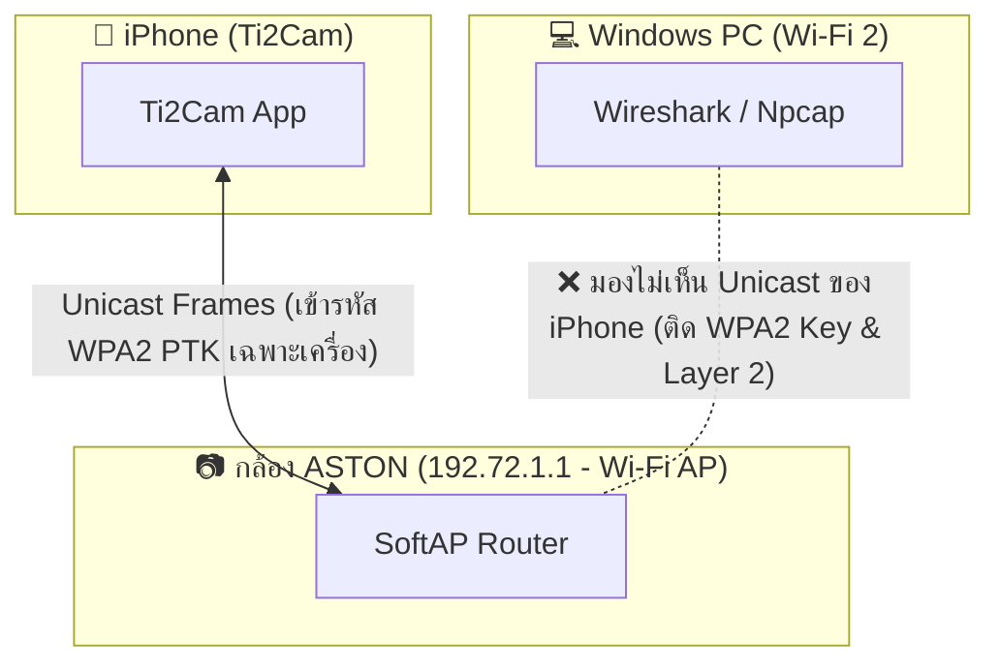
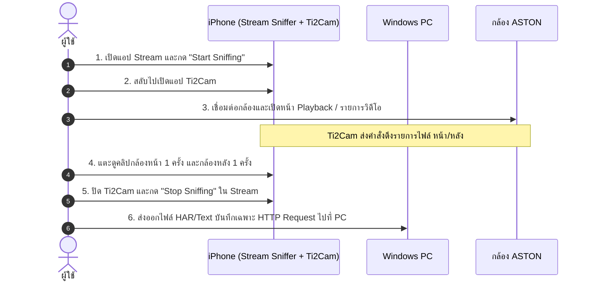

# PHASE 3C — Ti2Cam Network Protocol Capture Planning
**โครงการ:** ASTON Ultimate X WiFi 2K (iOS Replacement)  
**เป้าหมาย:** วางแผนดักจับ Network Traffic ระหว่าง iPhone (Ti2Cam) กับกล้อง ASTON Ultimate X เพื่อค้นหา API รายการวิดีโอที่แท้จริง  
**สถานะ:** แผนงานการทดสอบ (ห้ามเริ่มจับแพ็กเก็ตจริง และห้ามติดตั้งโปรแกรมโดยไม่ได้รับอนุมัติ)

---

## 1. การประเมินความเป็นไปได้ของเครื่องมือ (Tool Feasibility Analysis)

| เครื่องมือ | ความเป็นไปได้บน Windows | ข้อดี | ข้อจำกัดเชิงเทคนิค |
|---|---|---|---|
| **Wireshark + Npcap (บน PC)** | เป็นไปได้เฉพาะ Traffic ของ PC เอง | วิเคราะห์โปรโตคอลได้ละเอียดที่สุด (TCP/UDP/HTTP/RTSP) | **ไม่สามารถเห็น Unicast Traffic ของ iPhone ได้** เนื่องจาก Wi-Fi ของกล้องเข้ารหัส WPA2-PSK และการ์ด Wi-Fi 2 (TP-Link Nano) บน Windows ไม่รองรับ Monitor Mode |
| **Wi-Fi Monitor Mode (802.11 Sniffing)** | **เป็นไปไม่ได้** บน Windows ปัจจุบัน | สามารถดักจับเฟรม 802.11 ในอากาศได้ทั้งหมด | ไดรเวอร์ NDIS ของ Windows ไม่อนุญาตให้เปิด Monitor Mode แบบ Linux/macOS และต้องดักจับ 4-way Handshake เพื่อถอดรหัส PTK ของ iPhone |
| **HTTP Forwarding Proxy บน PC (เช่น Python Script / Fiddler)** | **เป็นไปได้สูง** | เห็น HTTP Request/Response ครบ 100% ไม่ต้องติดตั้งโปรแกรมเพิ่ม (เขียน Python ในเครื่องได้) | ขึ้นอยู่กับว่าแอป Ti2Cam ยอมรับการตั้งค่า HTTP Proxy ของ iOS หรือไม่ (หากแอปใช้ Raw Socket จะทะลุ Proxy) |
| **iOS Local Packet Capture App (บน iPhone)** | **เป็นไปได้สูงสุดและง่ายที่สุด** | ทำงานบน iPhone เครื่องจริงโดย **ไม่ต้อง Jailbreak** ดักจับ Traffic ทุกประเภทของแอปได้โดยตรง 100% | ต้องดาวน์โหลดแอปประเภท Network Sniffer จาก App Store ลงบน iPhone |

---

## 2. ข้อจำกัดของการจับแพ็กเก็ตผ่าน Wi-Fi AP ของกล้อง (AP Limitations)

1. **WPA2 Pairwise Transient Key (PTK):** แม้ PC และ iPhone จะต่อ Wi-Fi ชื่อเดียวกัน แต่การสื่อสารระหว่าง iPhone กับกล้องถูกเข้ารหัสด้วยคีย์เฉพาะเครื่อง (PTK) การ์ด Wi-Fi ของ PC จึงไม่สามารถดักฟังแพ็กเก็ตของ iPhone ได้
2. **Layer 2 Direct Isolation:** ตัวส่งสัญญาณ Wi-Fi ของกล้องส่งแพ็กเก็ตแบบ Unicast ตรงไปยัง MAC Address ของ iPhone การ์ด PC จะไม่ได้รับแพ็กเก็ตเหล่านี้เลยหากไม่ได้วิ่งผ่าน PC

---

## 3. วิธีการที่ทำได้จริงโดยไม่ต้อง Jailbreak และไม่แก้ Firmware

### วิธีที่ 1 (แนะนำเป็นอันดับ 1): iOS Local Packet Sniffer (บน iPhone โดยตรง)
- **หลักการ:** ใช้แอป Network Analyzer ฟรีบน iOS (เช่น **Stream - Network Sniffer** หรือ **HTTP Catcher** จาก App Store)
- **การทำงาน:** แอปจะสร้าง Local VPN/Loopback Profile ขึ้นมาบน iPhone เพื่อดักจับ HTTP/HTTPS/TCP Traffic ภายในเครื่องตนเองก่อนส่งออก Wi-Fi
- **ข้อดี:** ไม่ต้องดัดแปลง Windows, ไม่ต้อง Jailbreak, จับได้ทุก Request/Response 100% ทั้ง URL, Query Params, Headers, Body และ Status Code
- **การวิเคราะห์:** สามารถ Export ไฟล์ออกมาเป็น `.har` หรือ `.pcap` แล้วส่งมาวิเคราะห์บน PC ได้ทันที

### วิธีที่ 2 (แนะนำเป็นอันดับ 2): Zero-Install Python HTTP Proxy บน Windows PC
- **หลักการ:** รันสคริปต์ Python HTTP Proxy ขนาดเล็กบน PC (พอร์ต 8888) แล้วตั้งค่าใน iPhone:  
  *Wi-Fi `WK_CarDV_WiFi_7277` -> Configure Proxy -> Manual -> Server: `192.72.1.101`, Port: `8888`*
- **ข้อดี:** ไม่ต้องลงโปรแกรมใหม่บนทั้ง PC และ iPhone (ใช้ Python 3.14 ที่มีอยู่แล้ว)
- **ข้อจำกัด:** หาก Ti2Cam ออกแบบมาโดยไม่ผ่านระบบ Proxy ของ iOS วิธีนี้จะดักจับไม่ได้

---

## 4. วิธีที่ได้รับเลือกและมีประสิทธิภาพสูงสุด (Selected Best Method)

> [!TIP]
> **วิธีที่เลือก: วิธีที่ 1 (iOS App: Stream — Network Sniffer)**  
> **เหตุผล:** เป็นวิธีเดียวที่รับประกัน 100% ว่าจะเห็น Traffic ทั้งหมดที่ออกจากแอป Ti2Cam ไปยัง `192.72.1.1` โดยไม่ถูกขัดขวางด้วยข้อจำกัด WPA2 บน Windows และไม่ต้องปรับแต่ง Network Adapter ของ PC

---

## 5. ขั้นตอนการจับ Traffic เฉพาะช่วงเปิดรายการวิดีโอ (Step-by-Step Capture Workflow)

1. **เตรียมการ:** ติดตั้งแอป Stream จาก App Store และเชื่อมต่อ Wi-Fi `WK_CarDV_WiFi_7277`
2. **เริ่มบันทึก:** กดเริ่ม Sniffing ในแอป Stream
3. **ดำเนินกิจกรรมเป้าหมาย:**
   - เปิด Ti2Cam เข้าหน้า Playback
   - สังเกตการโหลดรายการไฟล์
   - สลับแท็บดูคลิปกล้องหน้า และกล้องหลัง
4. **หยุดบันทึก:** ปิดแอป Ti2Cam และกดหยุด Sniffing ทันที (จำกัดเวลาบันทึกรวมไม่เกิน 1–2 นาที เพื่อไม่ให้ไฟล์มีขนาดใหญ่เกินจำเป็น)
5. **ดึงข้อมูลเพื่อวิเคราะห์:** คัดลอกเฉพาะ URL Endpoint และพารามิเตอร์ที่พบออกมาวิเคราะห์

---

## 6. มาตรการปกปิดข้อมูลส่วนตัว (Data Privacy & Redaction)

ก่อนบันทึกข้อมูล Traffic ใดๆ ลงในรายงานโปรเจกต์ ต้องใช้กฎการคัดกรองดังนี้:
1. **รหัสผ่านและคีย์:** ปกปิดค่า `CryptoKey`, `password`, `token` ด้วย `[REDACTED_KEY]`
2. **พิกัดและเส้นทาง (GPS):** ปกปิดละติจูด/ลองจิจูดในพารามิเตอร์ NMEA หรือ EXIF ด้วย `[REDACTED_GPS]`
3. **เนื้อหาวิดีโอ/ภาพ:** **ห้ามดาวน์โหลดคลิปวิดีโอจริง** เก็บเฉพาะชื่อไฟล์ (Filename), โครงสร้าง Path, นามสกุลไฟล์ และขนาดไบต์ (Size) เท่านั้น

---

## 7. การประเมินความต้องการโปรแกรมและอุปกรณ์เพิ่มเติม

- **ฮาร์ดแวร์เพิ่มเติม:** **ไม่มี** (ใช้อุปกรณ์เดิม: iPhone, Windows PC, กล้อง ASTON)
- **ซอฟต์แวร์บน Windows:** **ไม่ต้องติดตั้งเพิ่ม** (คงสภาพแวดล้อมเดิม 100%)
- **ซอฟต์แวร์บน iPhone:** ติดตั้งแอปประเภท Network Sniffer ฟรีจาก Apple App Store (เช่น *Stream — Network Sniffer* โดย Cheng Peng)

---

## 8. สถานะการปฏิบัติตามข้อห้าม (Compliance Check)

- [x] **ไม่มีการติดตั้งโปรแกรมบน Windows**
- [x] **ยังไม่มีการเริ่มจับแพ็กเก็ตจริง**
- [x] **ไม่มีการเปลี่ยนค่า Network Adapter ใดๆ**
- [x] **ไม่มีการส่งคำสั่ง `action=set` หรือเปลี่ยนโหมดกล้อง**
- [x] **ไม่มีการเริ่มพัฒนาแอป iOS**
- [x] **ไม่มีการ Jailbreak iPhone 100%**
